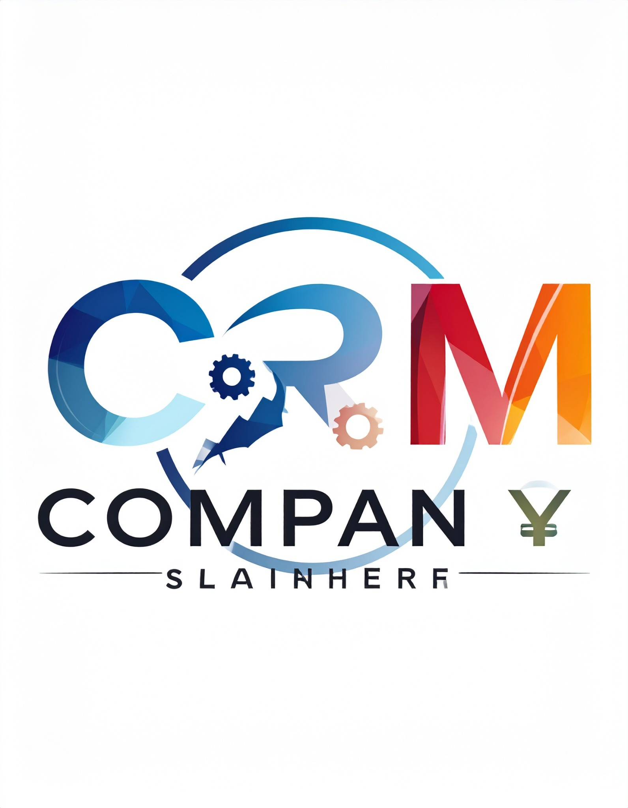

<div align="center">



# Consultoría estratégica para CRM Company

**Caso de estudio de estrategia empresarial, experiencia del cliente y gestión del talento**

</div>

## Descripción del proyecto

Este repositorio organiza una propuesta de consultoría estratégica para una empresa de software de gestión de relaciones con clientes (**CRM Company**, nombre utilizado para anonimizar el caso). El análisis se elaboró a partir de un trabajo académico de gerencia de recursos humanos y estrategia empresarial. Su propósito es mostrar cómo se integran herramientas de diagnóstico, formulación estratégica, indicadores de desempeño y prácticas de gestión del talento en una recomendación orientada a la fidelización y retención de clientes.

**Estado del proyecto:** análisis documental y propuesta. Las acciones descritas no se presentan como ejecutadas ni como resultados empresariales comprobados.

## Resumen ejecutivo

El caso plantea que la pérdida de clientes, la presión competitiva y algunas dificultades en la experiencia de usuario pueden limitar el crecimiento de una compañía SaaS. La recomendación central es priorizar la **penetración de mercado a través de la fidelización y retención**, en lugar de depender únicamente de la adquisición de nuevos clientes.

La propuesta agrupa cuatro líneas de trabajo:

1. **Experiencia del cliente:** mejorar el seguimiento posventa, la personalización, los canales de soporte y la detección temprana de señales de abandono.
2. **Producto y procesos:** priorizar el rendimiento, la usabilidad, la estabilidad móvil y la automatización de tareas repetitivas.
3. **Analítica e inteligencia artificial:** evaluar usos responsables de analítica predictiva para identificar riesgo de deserción y apoyar decisiones comerciales.
4. **Personas y organización:** fortalecer cultura colaborativa, gestión del cambio, comunicación, capacitación y definición de responsabilidades relacionadas con éxito del cliente y análisis de datos.

Estas líneas se articulan mediante el Balanced Scorecard (BSC), con indicadores para resultados financieros, satisfacción y retención, procesos internos y aprendizaje organizacional.

## Hallazgos que requieren atención

- La matriz de perfil competitivo (MPC) del documento base asigna una puntuación ponderada de **3,35** al caso anonimizado, frente a 3,40 para Salesforce, 3,25 para HubSpot y 3,20 para Zoho CRM. Son calificaciones del ejercicio académico; no constituyen una evaluación independiente ni una medición actual del mercado.
- La MEFE suma **3,01** según las ponderaciones consignadas en el documento fuente.
- La MEFI no puede darse por cerrada: falta la calificación y puntuación ponderada de la fila «Integraciones clave (WhatsApp)». El total de **2,09** suma únicamente las filas con puntuación disponible, mientras que el texto fuente también menciona 3,30 sin reconciliarlo con la tabla. Por rigor, este repositorio trata el resultado como **provisional e incompleto**.
- El documento base estima una facturación recurrente mensual cercana a **COP 29,25 millones** usando 117 clientes por COP 250.000 mensuales por cliente. Ese cálculo es aritméticamente consistente bajo dichos supuestos, pero las cifras no están auditadas ni verificadas como datos reales de una empresa.
- El documento fuente mezcla referencias a 117 clientes y a más de 10.000 clientes activos. Podrían ser unidades distintas (por ejemplo, empresas y usuarios), pero el texto no lo confirma. No se utilizan como una misma métrica.

## Alcance y metodología

El proyecto sintetiza el material fuente mediante herramientas de gestión estratégica y organizacional:

- Análisis PESTEL del entorno.
- Matriz de Perfil Competitivo (MPC).
- Matrices de Evaluación de Factores Externos (MEFE) e Internos (MEFI).
- Matriz DOFA y estrategias FO, DO, FA y DA.
- Balanced Scorecard, indicadores clave (KPI) y plan de acción.
- Propuesta de gestión humana: cultura, cambio, perfiles de cargo, capacitación y evaluación del desempeño.

La versión del repositorio mejora la estructura, señala inconsistencias matemáticas o de interpretación detectables en el texto disponible, anonimiza la marca del caso y transforma los plazos absolutos del documento en horizontes relativos. No añade afirmaciones sobre implementación real.

## Estructura del repositorio

```text
Consultoria-CRM/
├── README.md
├── assets/
│   └── logo.png
├── docs/
│   ├── 01-resumen-ejecutivo.md
│   ├── 02-analisis-pestel.md
│   ├── 03-matriz-mpc.md
│   ├── 04-matrices-mefe-mefi.md
│   ├── 05-matriz-dofa.md
│   ├── 06-balanced-scorecard.md
│   └── 07-propuesta-rrhh.md
├── data/
│   └── README.md
└── .gitignore
```

## Guía de lectura

Se recomienda comenzar por el [resumen ejecutivo](docs/01-resumen-ejecutivo.md), revisar después el diagnóstico del entorno y la competencia, y continuar con los factores internos y externos. La matriz DOFA sintetiza los diagnósticos y sirve de puente hacia el Balanced Scorecard y la propuesta de gestión humana.

| Documento | Propósito |
|---|---|
| [01. Resumen ejecutivo](docs/01-resumen-ejecutivo.md) | Problema, recomendación, viabilidad preliminar y hoja de ruta. |
| [02. Análisis PESTEL](docs/02-analisis-pestel.md) | Factores del entorno y posibles respuestas estratégicas. |
| [03. Matriz MPC](docs/03-matriz-mpc.md) | Comparación competitiva con factores ponderados. |
| [04. MEFE y MEFI](docs/04-matrices-mefe-mefi.md) | Evaluación de oportunidades, amenazas, fortalezas y debilidades. |
| [05. Matriz DOFA](docs/05-matriz-dofa.md) | Estrategias FO, DO, FA y DA priorizadas. |
| [06. Balanced Scorecard](docs/06-balanced-scorecard.md) | Objetivos, indicadores, metas de referencia, responsables y plazos relativos. |
| [07. Propuesta de RR. HH.](docs/07-propuesta-rrhh.md) | Cultura, gestión del cambio, perfiles, capacitación y desempeño. |

## Hoja de ruta propuesta

Los periodos siguientes son una sugerencia de planificación; comienzan una vez aprobada la propuesta y definida una línea base. No indican que las actividades se hayan realizado.

| Horizonte relativo | Prioridades sugeridas |
|---|---|
| Meses 0–1 | Validar cifras, definir línea base de churn, MRR y satisfacción; asignar responsables; revisar riesgos de privacidad. |
| Meses 1–3 | Mapear causas de abandono, priorizar correcciones de usabilidad/rendimiento y estandarizar el proceso de atención. |
| Meses 3–6 | Ejecutar pilotos de seguimiento proactivo y capacitación; medir adopción y satisfacción. |
| Meses 6–12 | Evaluar los pilotos, ampliar solo lo que muestre resultados medibles y actualizar la estrategia y el BSC. |

## Datos, supuestos y limitaciones

- **Anonimización:** se utiliza «CRM Company» como nombre del caso. No se incluyen nombres de integrantes del trabajo académico ni nombres de personas asociados con la estructura de la organización.
- **Cifras:** las cantidades financieras y metas incluidas provienen del documento académico y deben tratarse como estimaciones o referencias de planificación, no como datos auditados.
- **Fuentes:** la bibliografía heredada del informe base no fue objeto de verificación bibliográfica externa durante esta transformación. Antes de usar el trabajo como análisis de mercado vigente, conviene comprobar existencia, fecha, título y correspondencia de cada fuente.
- **Privacidad:** no se incorporan bases de datos de clientes ni registros identificables. Las métricas deben analizarse con datos agregados y autorización adecuada.
- **Tecnología:** la inteligencia artificial se formula como una opción a evaluar. No se afirma que esté integrada ni que haya producido ahorros o mejoras.
- **Naturaleza del trabajo:** es una propuesta de consultoría de carácter académico/profesional, no una auditoría financiera, tecnológica, jurídica ni de seguridad.

## Licencia y uso

Este repositorio **no incluye por ahora una licencia abierta**. No se concede mediante este README permiso general para redistribuir, modificar o reutilizar el material. Antes de agregar una licencia, confirma los derechos sobre el contenido original, el logotipo y las contribuciones de los integrantes del trabajo fuente.

## Siguientes mejoras posibles

Para fortalecer el portafolio, el próximo paso recomendado es adjuntar un conjunto de datos sintético y reproducible, documentar la fórmula de cada KPI y agregar visualizaciones del BSC una vez que las metas y líneas base estén validadas. No deben publicarse datos reales o confidenciales de una empresa sin autorización.
